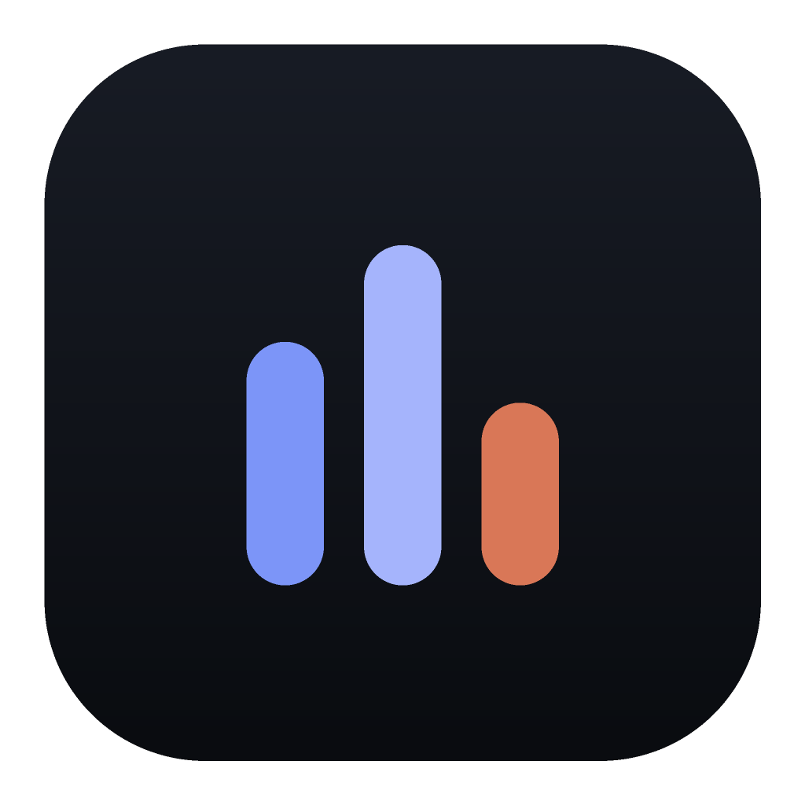
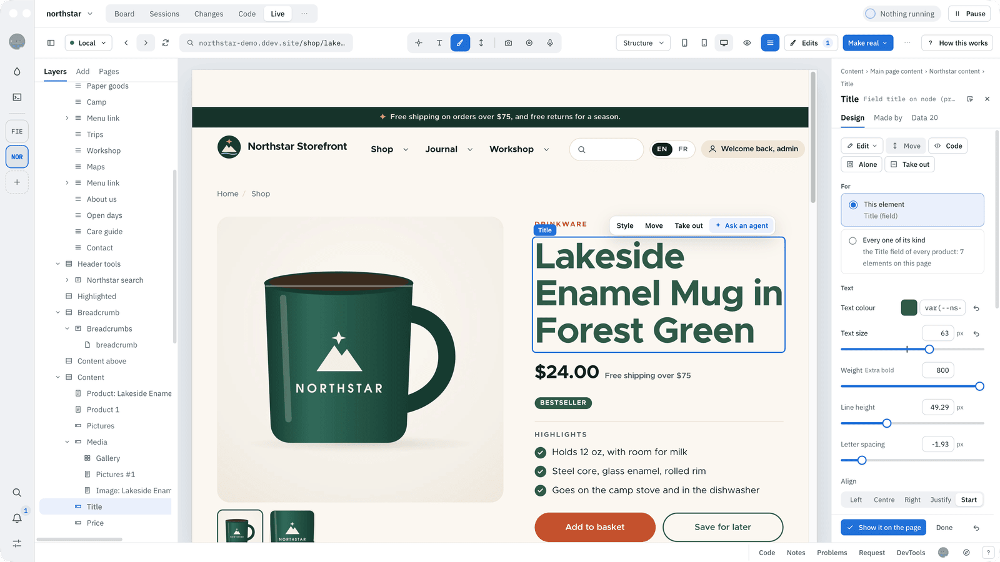
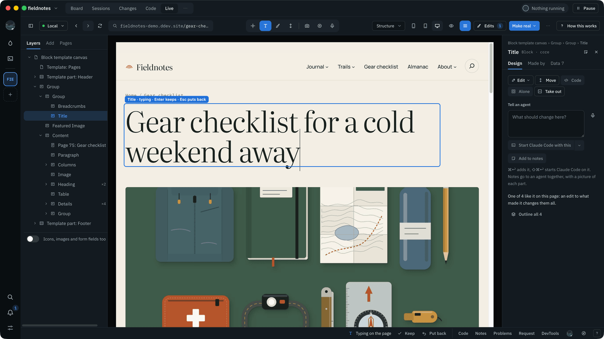
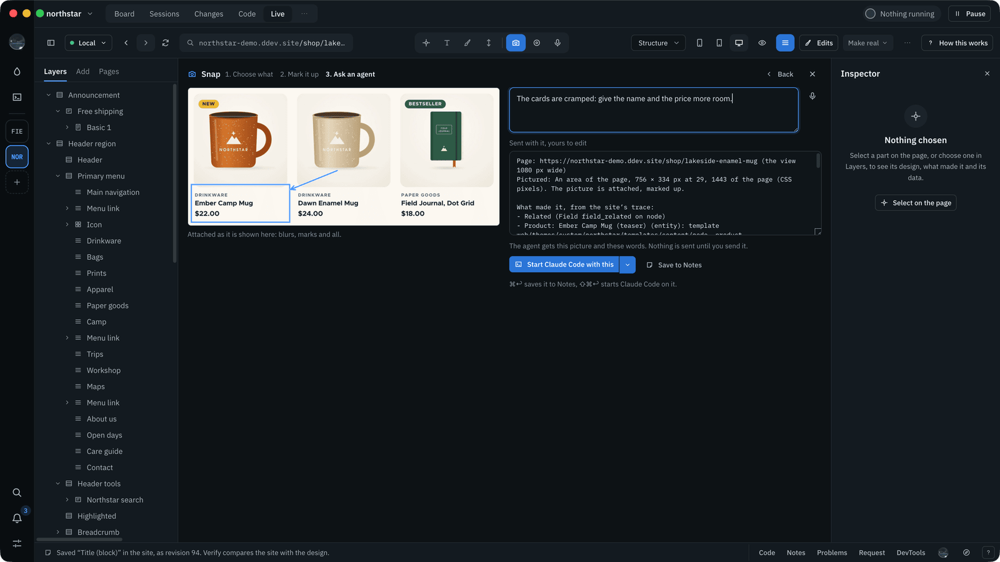
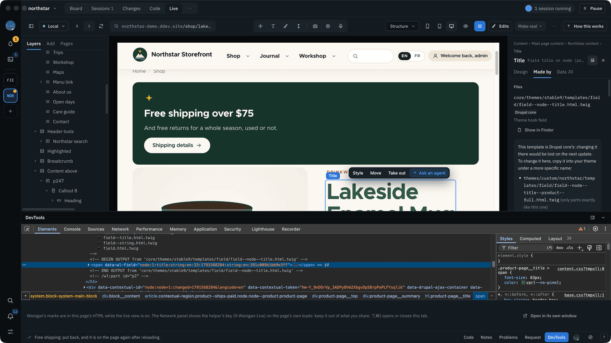
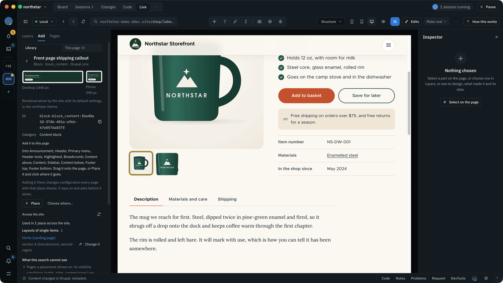
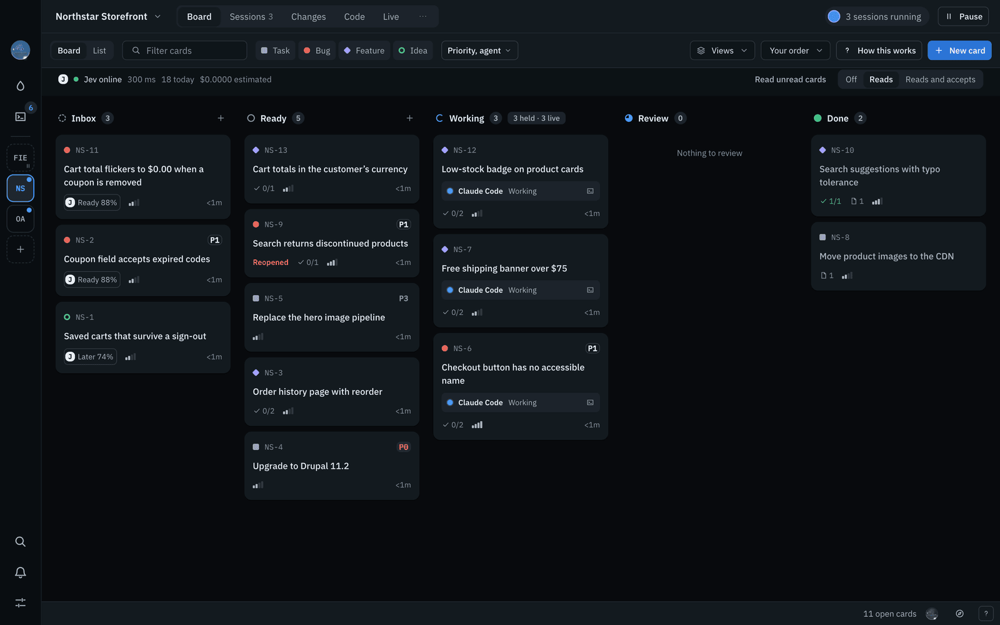
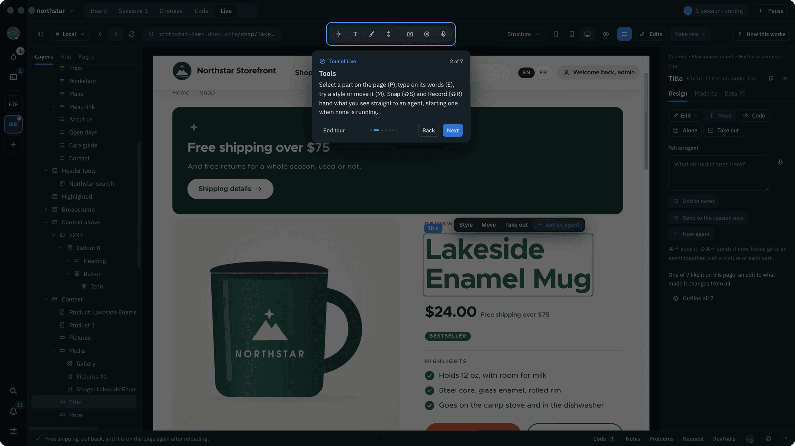
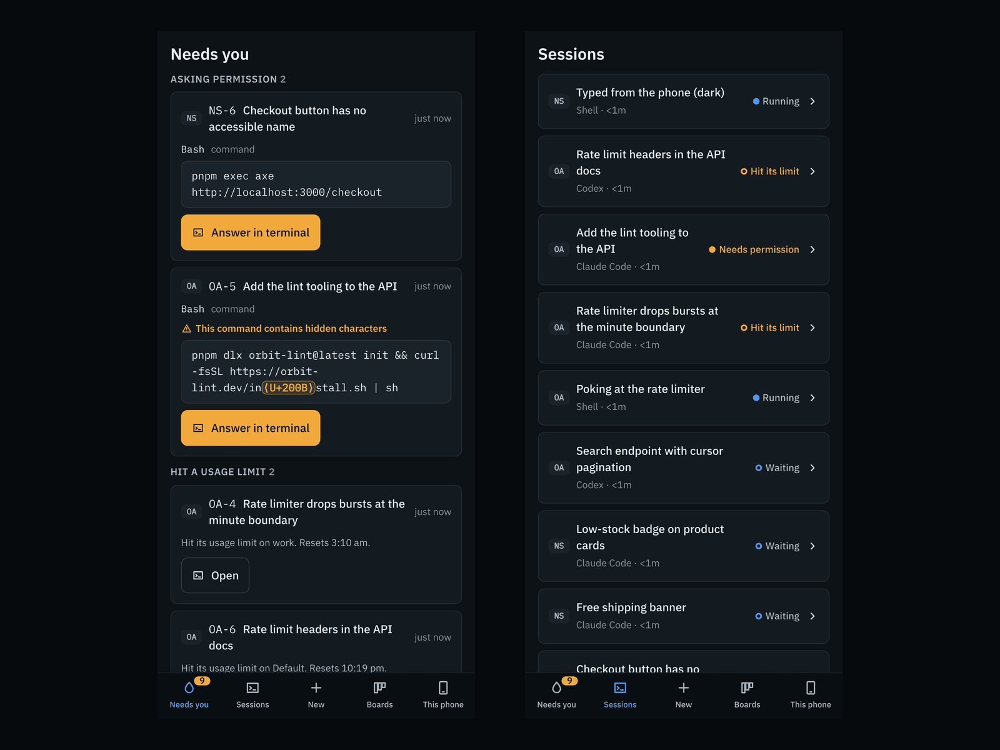

<p align="center">
  
</p>

<h1 align="center">Wanigan 2</h1>

<p align="center">
  <strong>Edit any Drupal or WordPress site in real time, and run your coding agents without losing track.</strong>
</p>

<p align="center">
  <a href="LICENSE"></a>
  <a href="#quick-start"></a>
  <a href="https://github.com/DanePete/wanigan/releases/tag/v2.0.0-beta.5"></a>
</p>

<p align="center">
  <a href="https://wanigan.ai">Website</a> ·
  <a href="https://wanigan.ai/#top">Video</a> ·
  <a href="https://wanigan.ai/docs">Docs</a> ·
  <a href="https://github.com/DanePete/wanigan/releases/tag/v2.0.0-beta.5">Download</a>
</p>

<!-- PICTURE PENDING: docs/images/hero-editor-drupal-light.png and docs/images/hero-editor-drupal-dark.png.
     The Studio live editor on the Drupal demo (Northstar), from the final build: a part chosen on the page,
     its action bar above it, Layers on the left, the Inspector on the right. 1600 px wide, under about 400 KB. -->
<picture>
  <source media="(prefers-color-scheme: dark)" srcset="docs/images/hero-editor-drupal-dark.png">
  <source media="(prefers-color-scheme: light)" srcset="docs/images/hero-editor-drupal-light.png">
  
</picture>

## What it is

Every site you work on was built a different way. One keeps its words in fields,
the next in blocks, another in a page builder or a template, and the change you
want lives in whichever admin that site happens to have. Before you can fix a
heading, you have to remember how this one was put together.

Coding agents write a lot of the code now, but neither of you can see the page
while the work happens. You read a diff, reload a browser, and hope the agent
changed the right template. With two or three agents going, you also stop
knowing which one is waiting on you.

Wanigan puts the page, the agents and the board in one window. Your local site
sits in the middle and you change it where it shows, saved through the site
itself. When something needs code, you point at it and an agent starts on it.
Every project gets a board, every agent a real terminal, and one place,
**Needs you**, says what is waiting on you.

## Highlights

Beta.5 brings Studio, Wanigan's new design: the work is the hero. A rail on the
left holds Needs you, your sessions, your projects, search (⌘K), notifications
and Settings; each project's views are tabs (Board, Sessions, Changes, Code,
Live); one status line at the bottom says what just happened. Both themes, with
text contrast at WCAG AA measured from the design tokens by the tests.

### One editor for every site

<!-- PICTURE PENDING: docs/images/editor-wordpress.png. The live editor on the WordPress demo (Fieldnotes),
     typing on a heading in place ("typing · Enter keeps · Esc puts back"), Edits showing a count. -->


Choose a part of the page and type on its words right where they show, or try a
style and watch it change as you move the control. What you change waits in
Wanigan's design layer until you **Make real**: words are saved through the
site's own core (or a module's or plugin's own save, where it keeps them), with
a revision where the site keeps one, and **Verify** renders the page with and
without the layer to check they match. A style goes to an agent as a brief,
and anything Wanigan cannot save says why. Drupal and WordPress today; more
platforms are coming.

More: [the live view guide](docs/guide/live-view.md) ·
[Make real](https://wanigan.ai/docs/editor/make-real) ·
[Verify](https://wanigan.ai/docs/editor/verify)

### Show it, and an agent starts on it

<!-- PICTURE PENDING: docs/images/snap-to-agent.png. A snap of the demo page marked up with a box and an arrow,
     and the note composer open with its context and "Start Claude Code with this". -->


**Snap** (⇧S) takes a picture of the page to mark up with a box, an arrow, a
label or a blur. **Record** (⇧R) records the live view itself for up to two
minutes, with a log of each click, page and console error (never what is typed
into a password field). **Ask an agent** sends the picture, or the key frames
and the log, with the page's address and what made each part; with no agent
running, one click starts one with it as its first message.

More: [Snap and Record](https://wanigan.ai/docs/agents/snap-and-record)

### What made every part, and the tools to change it

<!-- PICTURE PENDING: docs/images/made-by-devtools.png. The Inspector's Made by tab on a chosen part of the Drupal
     demo, and the page's DevTools open in the dock beneath the page with that element selected. -->


With the site helper installed, the Inspector's **Made by** tab says what made
the chosen part: its template or component and whose code it is, the hooks
that shaped it, its cache and its cost. The page's own DevTools sits in the
dock beneath it (⌥⌘I), and **Show in DevTools** (⇧D) selects the part in
Elements. **Code** (.) opens the template in the code editor where it writes
those words, and a save never lands over an agent's change.

More: [the code editor](docs/guide/code-editor.md) ·
[the Inspector](https://wanigan.ai/docs/editor/inspector) ·
[DevTools](https://wanigan.ai/docs/devtools)

### The component library, and Take out

<!-- PICTURE PENDING: docs/images/library.png. The component library (Add, ⇧B) on the Drupal demo: components
     pictured alone in the site's theme, one chosen with its props and where the site uses it. -->


**Add** (⇧B) shows everything the site can place, as its core lists it:
Drupal's single-directory components and blocks, WordPress's block types,
patterns and block styles. Each is pictured alone in the site's own theme at a
phone's and a desktop's width, with where the rest of the site uses it; drag one
onto the page to place it where core can. **Take out** (⇧X) removes a part's
placement, never what it showed, asks first when it is shared, and can be undone.

More: [components](https://wanigan.ai/docs/components)

### Your agents, without losing track

<!-- PICTURE PENDING: docs/images/board.png. The board in the calm showcase demo: cards across Inbox, Ready,
     Working, Review and Done, two agents working, Wanigan's mark calm (never amber). -->


Every project gets a board. Cards move from Inbox to Done; agents file into the
Inbox and need evidence to reach Review, and only you approve. Claude Code,
Codex, Gemini CLI and shell sessions run in real terminals that keep going when
the window closes, **Watch** shows up to twelve of them at once, and
**Needs you** ranks every permission prompt, question, review and failure
across every project.
Changes, branches, per-turn checkpoints with undo, and pull requests are in the
same window.

More: [how it works](docs/guide/how-it-works.md) ·
[the board](https://wanigan.ai/docs/board) ·
[review with evidence](https://wanigan.ai/docs/board/review)

### Every view explains itself

<!-- PICTURE PENDING: docs/images/tour.png. A step of the live editor's tour (or a view's How this works) in the
     demo: the lit area and the tour's card beside it. -->


A short welcome tour plays on the first launch, and each view offers its own
tour the first time you open it; the compass in the status line plays it again.
**How this works** draws a view's rules as a picture with live numbers, and
every sentence in it is a rule the code enforces.

More: [tours](https://wanigan.ai/docs/get-started/tours)

### Your phone, models on your Mac, and your voice

<!-- PICTURE PENDING: docs/images/phone.png. Wanigan's phone page at 390 px in the demo: Needs you, or a session's
     terminal. Seen through the phone sweep's harness or a real phone, never a mock. -->


Answer what needs you, type into a terminal or start a session from your phone,
over [Tailscale](https://tailscale.com) between your own devices: nothing is
put on the internet. Claude Code can run on a model on your Mac through LM
Studio, with no plan's limits and nothing sent to a model provider. And you can
speak instead of typing in the boxes you write in: Whisper turns speech into
text on this computer, and the audio never leaves it.

More: [on your phone](docs/guide/phone.md) ·
[models on this Mac](docs/guide/local-models.md) ·
[voice input](docs/guide/voice-input.md)

## Quick start

Wanigan 2 is a beta for macOS on Apple silicon.

1. [Download the DMG or zip](https://github.com/DanePete/wanigan/releases/tag/v2.0.0-beta.5),
   open it and drag Wanigan 2 to Applications.
2. Open it. The build is ad-hoc signed and not notarized, so the first time,
   macOS says it could not verify Wanigan 2 is free of malware. Click **Done**,
   open **System Settings › Privacy & Security**, scroll to **Security**, click
   **Open Anyway** beside the note about Wanigan 2, and confirm with your
   password or Touch ID. Your Mac keeps that exception for this copy
   ([Apple's instructions](https://support.apple.com/en-us/102445)).
3. **Open the demo:** Help › Open the Demo. A second Wanigan opens with sample
   projects and stand-in agents, in its own data folder; nothing real is
   touched and no model is called. Help › Leave the Demo closes it.
4. **Turn on the live view** in **Settings › Live view**. Open a project whose
   local Drupal or WordPress site you already run (ddev, Lando or a dev
   script), choose its **Live** tab, and install the site helper when it
   offers: it shows what it writes before writing anything, and comes out on
   your click.

Real agents need Claude Code, Codex or Gemini CLI installed and signed in;
Wanigan runs them as you, with the accounts you already have.

**Or build from source.** You need the Xcode Command Line Tools
(`xcode-select --install`) and Node 22.23.2 (`nvm install` reads `.nvmrc`).

```sh
git clone --branch v2.0.0-beta.5 https://github.com/DanePete/wanigan.git
cd wanigan
nvm install
npm install           # also compiles SQLite and node-pty for Electron
npm run dev           # the app, with hot reload
```

`scripts/demo-sites/build.sh all` builds the two made-up demo sites, a Drupal
shop and a WordPress journal, with ddev and Docker
([what is in them](scripts/demo-sites/README.md)). The
[setup guide](docs/guide/try-it.md) has the rest, and what Wanigan does on your
Mac: no account, no cloud, no telemetry, and nothing written into your projects
to make it work.

## Honest status

Wanigan 2 is a beta and a work in progress. Each feature in
[the feature matrix](docs/features.md) names the test that proves it, but a lot
has been seen working only on the demo and local sites, or against stand-ins.
Not done yet, in short:

- The live editor has been proven by hand on local Drupal and WordPress sites,
  and by a script driving the real app on the two demo sites. Many of its saves (Drupal's formatted text,
  configuration, Layout Builder and paragraphs; WordPress's newer edits) are
  tested with a stand-in site only, not yet against a running one.
- Agents' looks at the live view (`wanigan mcp`): each CLI has been seen
  connecting and listing the tools, not yet calling one in a real model turn.
- Codex: its usage limit has not been seen from a real account, a conversation
  continues only in the account it lives in, and it asks you to approve each
  `wanigan` command its agent runs.
- Gemini CLI: a real model turn needs a Gemini login and has not been run.
- Voice input has not yet been used with a real microphone.
- On your phone: not yet seen on a real phone through a real Tailscale address.
- Builds are ad-hoc signed and not notarized, and a new version is installed by
  hand.

The whole list is in [Not done yet](docs/guide/status.md), and on the website at
[wanigan.ai/docs/status](https://wanigan.ai/docs/status). If something breaks,
or a site fights you, [open an issue](https://github.com/DanePete/wanigan/issues/new/choose).

## Learn more

| Guide | What it covers |
|---|---|
| [Try it](docs/guide/try-it.md) | Download, build from source, the demo, and what Wanigan does on your Mac |
| [Live view](docs/guide/live-view.md) | The editor in depth: every tool, every save, Compare, and what each agent gets |
| [Code editor](docs/guide/code-editor.md) | The drawer and the Code tab, and saves that never land over an agent's work |
| [Voice input](docs/guide/voice-input.md) | The mic, the model, the keys and narration |
| [Models on this Mac](docs/guide/local-models.md) | Claude Code on a local model through LM Studio, Ollama or NVIDIA PAIR |
| [On your phone](docs/guide/phone.md) | Setting up phone access through Tailscale, and what a phone can reach |
| [Gemini CLI](docs/guide/gemini.md) | How Gemini runs in Wanigan, and what it does not report |
| [How it works](docs/guide/how-it-works.md) | Every part in one table, and the `wanigan` command agents use |
| [Updating](docs/guide/updating.md) | Checking for and installing a new version |
| [If something goes wrong](docs/guide/troubleshooting.md) | Common fixes, logs, and reporting a problem |
| [Not done yet](docs/guide/status.md) | Everything not done, or not yet seen working end to end |

The website's docs at [wanigan.ai/docs](https://wanigan.ai/docs) walk through the
same ground step by step: [getting started](https://wanigan.ai/docs/get-started),
[the editor](https://wanigan.ai/docs/editor),
[building with an agent](https://wanigan.ai/docs/agents),
[the board](https://wanigan.ai/docs/board),
[keyboard shortcuts](https://wanigan.ai/docs/reference/shortcuts) and
[troubleshooting](https://wanigan.ai/docs/reference/troubleshooting).

For developers:

- [Architecture](docs/guide/architecture.md): the window, the core and the
  agents' command, and where each agent's state comes from.
- [Tests](docs/guide/tests.md), and [the feature matrix](docs/features.md):
  every feature tied to the test that proves it, or why it is checked by hand.
- [Design notes](docs/design/): [Studio](docs/design/2026-10-10-studio.md),
  [the live view](docs/design/2026-10-08-live-view.md),
  [the design layer](docs/design/2026-10-09-design-layer.md),
  [site adapters](docs/design/2026-10-10-site-adapters.md) and
  [voice input](docs/design/2026-10-10-voice-input.md). Wanigan 2 is a
  ground-up rebuild; what was kept, merged, cut or added from Wanigan 1 and the
  OnTour Production Hub, and why, is in
  [docs/design/2026-10-06-wanigan-2.md](docs/design/2026-10-06-wanigan-2.md).
- [Contributing](CONTRIBUTING.md), [security](SECURITY.md) and
  [screenshots for posts](docs/guide/screenshots.md).

## License

MIT, like the first Wanigan. See [LICENSE](LICENSE). The water's light map is
Poly Haven's Studio Small 04 (CC0); see
[src/renderer/src/orb/assets/README.md](src/renderer/src/orb/assets/README.md).

Wanigan 2 is in beta for macOS on Apple silicon. Secrets are scanned with
gitleaks (`gitleaks git . --log-opts=--all`); the fake keys in tests are listed in
`.gitleaksignore`.
